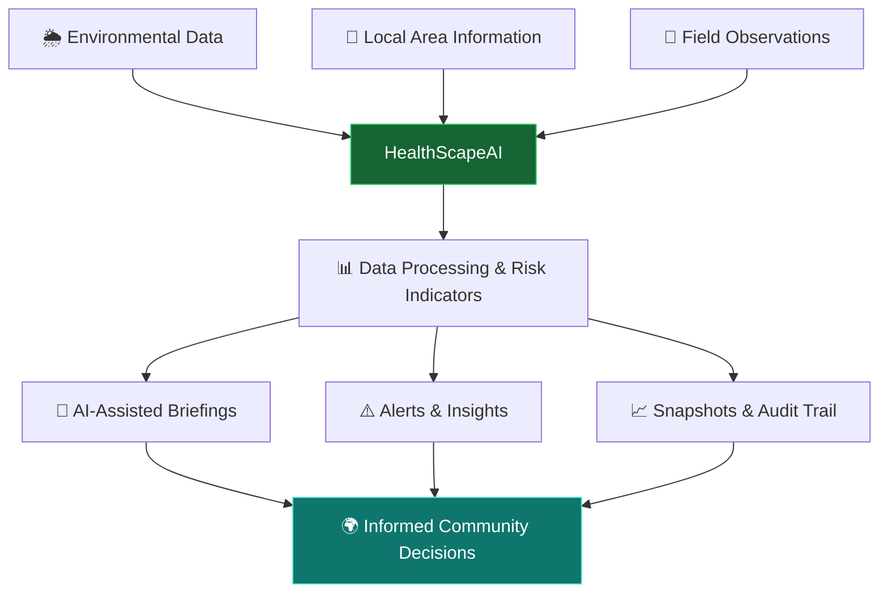

# 🌍 HealthScapeAI
### AI-Powered Environmental & Public Health Intelligence

<p align="center">
  
</p>

<p align="center">
  
  
  
  
</p>

<p align="center">
  <b>🌱 Know your area. Understand the risk. Know what to do.</b>
</p>

<p align="center">
  An environmental intelligence platform designed to help communities explore local conditions, understand potential environmental risks, and make more informed decisions.
</p>

---

## ✨ The Vision

Environmental information is often scattered across multiple sources. HealthScapeAI brings environmental data, area-level insights, risk assessment, and actionable guidance together in one experience.

Our goal is to make environmental intelligence more **understandable, accessible, transparent, and actionable**.

> 🌿 From environmental data to meaningful community action.

## 🚀 Explore the Platform

| Feature | What it offers |
|---|---|
| 🌦️ **Environmental Dashboard** | Explore environmental conditions and weather-related insights. |
| 📍 **Area Intelligence** | Discover information about localities and understand their environmental context. |
| 🧠 **AI-Assisted Briefings** | Generate concise explanations of environmental conditions when the optional AI integration is configured. |
| ⚠️ **Risk Assessment** | Explore environmental risk indicators through the risk calculator. |
| 🔔 **Alerts & Monitoring** | Access alert-related functionality and environmental updates. |
| 📸 **Field Observations** | Support the recording of observations from the field. |
| 📊 **Historical Snapshots** | Keep track of captured environmental information over time. |
| 🛡️ **Audit & Security** | Support traceability and access control through application security and audit functionality. |

## 🎯 Why HealthScapeAI?

- 🌍 **Local-first perspective** — focus on environmental conditions at the area level.
- 🧩 **Connected insights** — bring environmental information and risk indicators into one platform.
- 🤖 **AI-assisted understanding** — make complex information easier to interpret.
- 📈 **Data-informed decisions** — encourage users to understand the available evidence before acting.
- 🔎 **Transparency matters** — environmental insights should be interpreted in context, not treated as guaranteed medical predictions.
- 📱 **Designed for accessibility** — a foundation for delivering useful information to diverse communities.

## 🏗️ Technology Stack

<p align="center">
  
</p>

| Layer | Technology |
|---|---|
| Application backend | Java 21 |
| Web framework | Spring Boot |
| Security | Spring Security |
| Data access | Spring Data JPA / Hibernate |
| Database | MySQL-compatible TiDB Cloud |
| Build system | Apache Maven |
| Environmental data | Open-Meteo integration |
| Optional AI integration | Gemini API |
| Deployment foundation | Docker, Docker Compose and deployment configuration |
| CI/CD foundation | GitHub Actions configuration |

*The availability of individual integrations depends on their configuration and the corresponding environment variables or API credentials.*

## 🧭 How It Works



## ⚡ Run Locally

### Prerequisites

- Java 21
- Apache Maven 3.9+
- A reachable MySQL-compatible database, such as TiDB Cloud
- Optional AI credentials if you want to enable the AI integration

### 1. Clone the repository

```bash
git clone https://github.com/mollachandhana-cpu/HealthScape.git
cd HealthScape
```

### 2. Configure environment variables

Configure your database settings using environment variables. Never commit your real credentials.

**macOS / Linux:**

```bash
export DATABASE_URL='jdbc:mysql://YOUR_DATABASE_HOST:4000/healthscape?sslMode=VERIFY_IDENTITY'
export DATABASE_USER='YOUR_DATABASE_USERNAME'

read -s "DATABASE_PASSWORD?Enter database password: "
export DATABASE_PASSWORD
echo
```

Replace the example host and username with your actual database details.

If the optional Gemini integration is enabled, configure its API key using the exact environment variable expected by your application.

### 3. Build the project

```bash
mvn clean package
```

### 4. Start the application

```bash
mvn spring-boot:run
```

Open the application in your browser:

**http://localhost:8080**

If the application uses additional required environment variables, configure them before starting it.

## 🐳 Deployment

HealthScapeAI includes deployment-related configuration intended to support containerized builds and deployment workflows.

Example local Docker workflow, if Docker is installed:

```bash
docker build -t healthscapeai:local .
docker run --rm -p 8080:8080 \
  -e DATABASE_URL="$DATABASE_URL" \
  -e DATABASE_USER="$DATABASE_USER" \
  -e DATABASE_PASSWORD="$DATABASE_PASSWORD" \
  healthscapeai:local
```

You can also configure a remote CI/CD workflow to build and publish a container image without installing Docker on your development machine.

**Before deploying publicly:** configure production secrets, restrict database access, verify health checks, test database migrations, and confirm that the deployed application behaves correctly.

## 🔐 Security & Responsible Use

HealthScapeAI is intended to support environmental awareness and informed decision-making.

- Never commit `.env` files, database passwords, or API keys.
- Store production credentials in your hosting platform's secret manager.
- Use HTTPS and appropriately restricted database access in production.
- Validate external data and handle API failures gracefully.
- Clearly communicate missing, stale, or uncertain data.
- Treat environmental risk indicators as informational, not as medical diagnoses.
- Test authentication, authorization, and input validation before public deployment.

## 🗺️ Roadmap

- [x] Environmental dashboard foundation
- [x] Area intelligence and risk assessment foundation
- [x] Environmental data integration
- [x] AI-assisted briefing integration
- [x] Alerts, observations, and snapshots foundation
- [ ] Automated build and test pipeline
- [ ] Remote container build and deployment
- [ ] Comprehensive integration and security testing
- [ ] Improved multilingual and low-bandwidth experiences
- [ ] Expanded environmental data validation and freshness indicators

*Roadmap items describe development goals; production readiness depends on testing and deployment verification.*

## 🤝 Contributing

Ideas, improvements, bug reports, and thoughtful feedback are welcome.

1. Fork the repository.
2. Create a feature branch.
3. Make your changes and test them.
4. Open a pull request describing the improvement.

## 👩‍💻 Built With Purpose

**HealthScapeAI — Environmental Intelligence for Healthier Communities.**

<p align="center">
  
  
</p>

<p align="center">
  <i>Better awareness. Better decisions. Healthier communities. 🌎</i>
</p>
